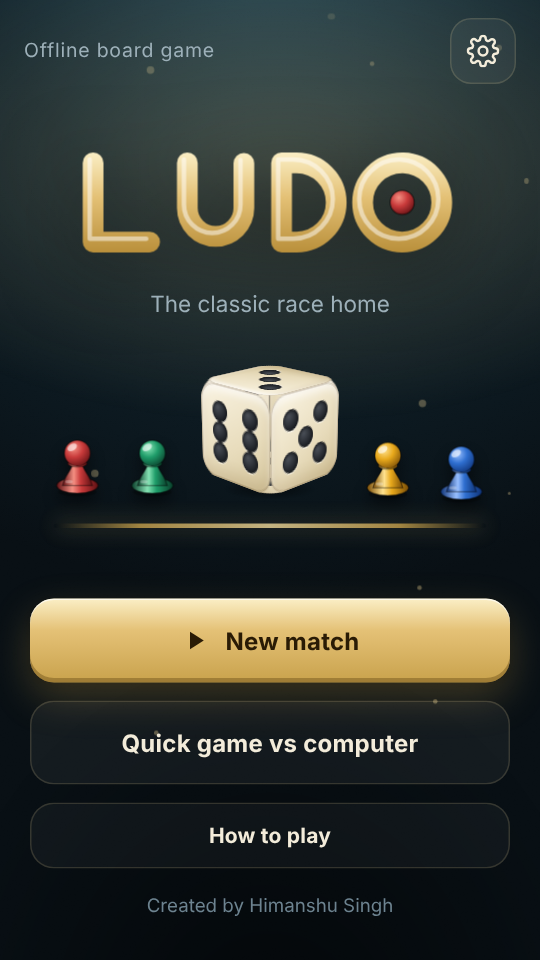
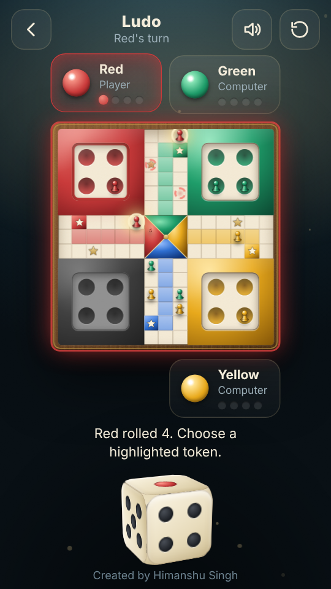

# Ludo Offline

A classic Ludo board game for two to four players that installs like an app and plays fully offline. One HTML file, no dependencies, no build step.

Created by Himanshu Singh.

  
  

## Play

Open the GitHub Pages link for this repo in a browser. On Android, Chrome offers **Install app** (also on the home screen of the game); once installed it works with no connection.

To run it locally, serve the folder with any static server, for example `python3 -m http.server`, and open `http://localhost:8000`. The service worker needs `http://localhost` or HTTPS, so opening `index.html` straight from disk works for playing but not for installing.

## Features

- 15 × 15 board with four yards, a 52-square clockwise track, eight safe squares (four starts and four stars) and four five-square home columns.
- 2, 3 or 4 players. Each seat can be Human, Computer or Off. Two-player games use opposite corners (Red vs Yellow).
- Heuristic computer opponent that enters home, captures, escapes danger and leaves the yard, with a 500 ms thinking delay.
- 3D CSS dice, hopping tokens, capture and home effects, ghost markers showing where a token would land.
- Synthesized sound effects (Web Audio, no audio files) and vibration on supported phones. Both can be switched off in Settings.
- Auto-save at the start of every turn, with a Continue card on the home screen.
- Installable PWA: standalone display, app icons, a "Quick game" shortcut, screen stays awake during a match, and Android back button support.

## Rules

- Roll a **6** to move a token out of the yard onto your start square.
- Tokens travel clockwise, then turn into their coloured home column. You need the **exact** roll to enter the centre.
- Landing on an opponent outside a safe square **captures** it and sends it back to its yard. Start squares and stars are safe for everyone.
- A **6**, a **capture**, or **getting a token home** gives another roll.
- **Three 6s in a row** forfeit the third move and pass the turn.
- If no move is legal, the turn passes after a short pause.
- The first player to bring all four tokens home wins. The others can keep playing for the remaining places.

## Files

| File | Purpose |
| --- | --- |
| `index.html` | The whole game: board, rules, AI, interface, audio, saving |
| `manifest.json` | Install metadata: name, icons, shortcut, screenshots |
| `sw.js` | Service worker, cache-first, for offline play |
| `icon-192.png`, `icon-512.png`, `icon-maskable-512.png` | App icons |
| `screenshots/` | Images used by the install prompt and this README |

## Deploying to GitHub Pages

1. Push these files to the `main` branch.
2. In the repository, open **Settings → Pages**, choose **Deploy from a branch**, then `main` and `/ (root)`.
3. Open the published link. All paths in the manifest and service worker are relative, so it works from a repository subpath.

### Shipping an update

Installed copies keep serving the cached version until the cache name changes. When you edit any file, bump `CACHE_NAME` in `sw.js` (`ludo-offline-v3` → `ludo-offline-v4`). Players then see an "Updated to the latest version" message with a Reload button.

## How the code is organised

`index.html` is a single script split into sections, in this order:

1. **Hooks**: `onDiceRoll`, `onTokenHop`, `onCapture`, `onVictory`, `onStateChange`. Sound, vibration, effects and saving attach here. The game logic never depends on them.
2. **Geometry**: the `TRACK`, `HOME_COL`, `START` and `STAR_INDICES` tables, plus `verifyGeometry()`, which checks adjacency, wrap-around and home-column entry (`(startIndex + 50) % 52`).
3. **Rules** and **AI**: pure functions over a `{ color: [position × 4] }` map. A token's position is `-1` in the yard, `0–50` on the track relative to its own start, `51–55` in the home column and `56` home.
4. **Sound**, **Haptics**, **Persistence**.
5. **Game state machine**: `WAITING_FOR_ROLL → ROLLING → SELECTING_TOKEN → ANIMATING_MOVE → GAME_OVER`.
6. **View**, **sheets and dialogs**, **navigation**, **setup** and **app shell**.

The page exposes `window.Ludo` for debugging, which makes the game easy to drive from a test script.

## Credits

Created by Himanshu Singh.
